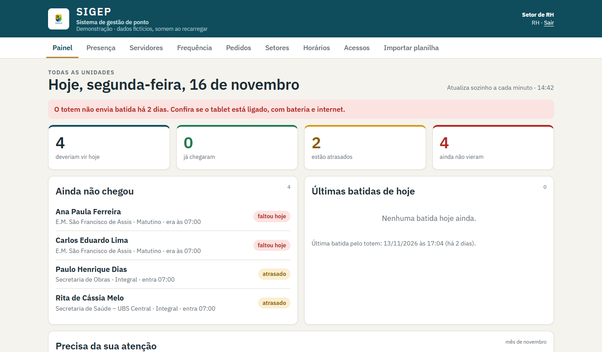
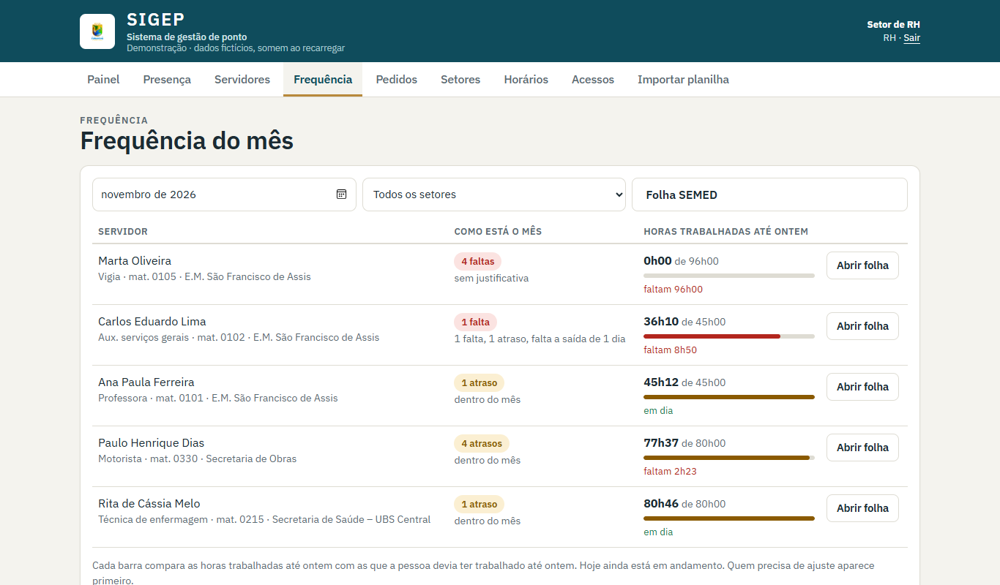

# SIGEP – Sistema de Gestão de Ponto

**Ponto eletrônico para a Prefeitura de Tonantins/AM: totem com QR Code em cada setor, painel do RH, chefias, Prefeito e servidor.**

Substitui o caderno de assinaturas por um sistema web instalável no celular e no tablet, com as regras de acesso dentro do próprio banco de dados.


**[▶ Testar a demonstração](https://anndreluizz.github.io/sigep/demo.html)** (dados fictícios; entre com `rh@demo`, `chefe@demo`, `prefeito@demo`, `servidor@demo` ou `totem@demo`, senha `demo1234`)



## O que faz

**No setor**
- Totem num tablet: o servidor aproxima o crachá com QR Code, o totem registra a entrada ou a saída e tira uma foto pequena da batida (só o RH vê; apagada em 90 dias)
- Funciona sem internet: guarda as batidas e envia quando a conexão volta

**RH e chefias**
- Painel do dia: quem ainda não chegou, quem está atrasado, últimas batidas e alerta se o totem parou de enviar
- Cadastro de servidores, setores, turnos, escalas, feriados e vários vínculos
- Justificativas (esqueci de bater, atestado, abono) com pedido, análise e histórico
- Frequência mensal com fechamento do mês e **Folha SEMED**: imprime, por unidade, uma folha por categoria no modelo da Secretaria de Educação
- Importação de servidores por planilha

**Prefeito e servidor**
- O Prefeito acompanha todos os setores, só para leitura
- O servidor vê a própria folha de ponto e pede justificativa pelo celular

| Presença do dia | Frequência mensal |
|---|---|
|  |  |

*Telas com dados fictícios da demonstração.*

## Segurança e privacidade

- **As regras ficam no banco, não no app.** Políticas de acesso por linha (RLS) no PostgreSQL: mesmo quem mexer no navegador não consegue burlar os perfis.
- Cada perfil só vê e altera o que lhe cabe (RH, secretaria/chefe, Prefeito, servidor, totem). CPF e telefone só aparecem para quem precisa.
- Todo ajuste de servidor, batida ou perfil vai para um **histórico de auditoria** (quem, quando, antes e depois). Mês fechado não aceita alteração.
- Página de privacidade com o uso dos dados, conforme a LGPD ([privacidade.html](privacidade.html)).

## Como funciona

Páginas web estáticas (HTML, CSS e JavaScript, sem framework) + banco no Supabase. Não precisa de servidor próprio.

```
Navegador / tablet (PWA)  ──▶  Supabase (PostgreSQL + Auth)
 index.html · totem.html         regras de acesso (RLS) e funções no banco
```

## Testes

Um Postgres de verdade (PGlite) roda na hora e cada perfil tenta o uso certo e o indevido. O CI do GitHub roda tudo a cada envio.

```
cd supabase && npm install && npm test
```

Para abrir a demonstração no computador: `python -m http.server` na pasta do projeto e acesse http://localhost:8000/demo.html

## Colocar no ar

Passo a passo, perfis e permissões em [`supabase/LEIAME.md`](supabase/LEIAME.md).

---

Desenvolvido por [André Luís Coelho Lopes](https://github.com/anndreluizz) · Tonantins, AM
